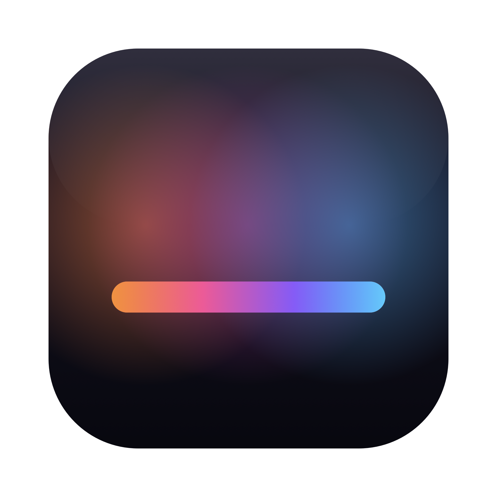

<p align="center">
  
</p>

<h1 align="center">Glowdeck</h1>

<p align="center">
  <b>Every light in your house, one glass menu away.</b><br>
  A native macOS menu bar app for USB monitor light bars and Wi-Fi smart lights, with themes, smooth effects and a dashboard for the whole home.
</p>

---

## What it does

- **Menu bar control.** Click the icon, pick a theme, colour or effect, drag brightness and speed. Liquid Glass on macOS 26+, frosted glass on 14–15.
- **Themes** for the whole house or one room: Focus, Evening, Sunset, Ocean, Aurora, Fireplace, Movie, Party, Calm.
- **Effects** rendered on your Mac at 30 fps: rainbow, cycle, breathe, wave, gradient, comet, sparkle, fire, aurora, candle. On LED strips they move along the strip; across bulbs they travel from light to light.
- **Built-in effects** from each light's own firmware (Nanoleaf scenes, WLED effects, WiZ scenes…).
- **Dashboard** with rooms, live colour previews, rename, identify, and pairing for hubs.
- **Sleeps with your display.** Lights turn off when the screen sleeps and come back exactly as you left them, including after the light lost power.
- **Monitor KVM friendly.** USB lights plugged into a monitor's hub are re-detected and restored when you switch computers.
- **Local only.** No account, no cloud. Everything talks to your lights over USB or your home network. Hub tokens are stored in the macOS Keychain.

## Supported lights

| Family | Connection | Setup | Status |
|---|---|---|---|
| ROBOBLOQ / DX-Light USB monitor light bars (`1A86:FE07`) | USB HID | none | ✅ tested on hardware |
| WLED | Wi-Fi (JSON + UDP realtime) | none | 🧪 implemented from docs |
| Philips Hue | Wi-Fi (bridge, local API) | press bridge button | 🧪 implemented from docs |
| LIFX | Wi-Fi (LAN protocol) | none | 🧪 implemented from docs |
| WiZ | Wi-Fi (UDP) | none | 🧪 implemented from docs |
| Govee | Wi-Fi (LAN API) | enable *LAN Control* in Govee app | 🧪 implemented from docs |
| Yeelight | Wi-Fi (LAN control) | enable *LAN Control* in Yeelight app | 🧪 implemented from docs |
| Nanoleaf | Wi-Fi (Open API) | hold power button | 🧪 implemented from docs |
| Elgato Key Light / Light Strip | Wi-Fi (HTTP) | none | 🧪 implemented from docs |
| **Anything in Home Assistant** (Tuya, Matter, Zigbee, IKEA, Z-Wave…) | Home Assistant REST API | paste a token | 🧪 implemented from docs |

🧪 means the driver follows the vendor's published local protocol but hasn't been checked on real hardware yet. If you own one of these lights, a quick report (works / doesn't) in an issue is hugely helpful.

**Not supported directly:** Tuya/Smart Life (needs cloud-issued keys; use Home Assistant), HomeKit (Apple only exposes it to iOS/Catalyst apps; use Home Assistant's HomeKit integration), cloud-only lights.

## Install

### From source

Requires macOS 14+ and Swift 6 (Xcode 16+ or the Command Line Tools).

```bash
git clone https://github.com/pcauhi/glowdeck.git
cd glowdeck
scripts/bundle.sh --install     # builds Glowdeck.app, copies it to /Applications and opens it
```

The app is ad-hoc signed. The first time, macOS may ask you to allow it in **System Settings → Privacy & Security**. It will also ask for **Local Network** access, which is needed to find Wi-Fi lights.

Turn on **Settings → Open Glowdeck at login** in the dashboard to keep it in your menu bar.

> **Building without Xcode:** the Command Line Tools for macOS 27 don't ship SwiftUI's macro plugin. `scripts/bundle.sh` automatically builds against an installed macOS 26.x SDK in that case.

## Using it

- **Menu bar icon:** themes, colour, effects, brightness, speed. The chips at the top choose what you're controlling: all lights, a room, or one light.
- **Dashboard** (from the menu): create rooms, move lights into them (••• on a light card), rename, identify, and pair hubs under **Add lights**.
- **Sleep with display** in the menu footer turns lights off with your screen.

## How it works

```
Sources/
  GlowdeckCore/              library, no UI
    Model/                   RGB, LightDevice base class, LightState, Theme, Effect
    Drivers/                 one file per light family (provider = discovery, light = control)
    Support/                 UDP sockets, HTTP, Bonjour, Keychain, pairing
    LightManager.swift       device registry, 30 fps render loop, sleep/wake, persistence
  Glowdeck/                  SwiftUI app: menu bar extra + dashboard window
Tests/GlowdeckCoreTests/     packet tests against captures from real devices
```

Each light is a `LightDevice` subclass with `setPower`, `setBrightness`, `setColor`, optional `setFrame` (per-LED) and `startNativeEffect`. A `DeviceProvider` discovers them. The manager renders effects and throttles each light to its own `maxFPS`: 25 fps for USB strips, about 2 fps for hub-based bulbs, which get smooth transitions instead.

Settings live in `~/Library/Application Support/Glowdeck/state.json`.

## Contributing

New drivers are very welcome; most are about 100 lines. See [CONTRIBUTING.md](CONTRIBUTING.md).

```bash
swift build
swift test

# Command Line Tools only (no Xcode): use a 26.x SDK and point at the testing macro plugin
SDKROOT=$(ls -d /Library/Developer/CommandLineTools/SDKs/MacOSX26*.sdk | tail -1) \
  swift test -Xswiftc -plugin-path -Xswiftc /Library/Developer/CommandLineTools/usr/lib/swift/host/plugins/testing
```

## Credits

The ROBOBLOQ USB protocol was reverse-engineered by the community. Thank you to
[tanmaster/light-control-rs](https://github.com/tanmaster/light-control-rs),
[hacmiu/synclight-pro](https://github.com/hacmiu/synclight-pro),
[jakebuild/synclight](https://github.com/jakebuild/synclight) and
[danodoms/openlamp-robobloq-macos](https://github.com/danodoms/openlamp-robobloq-macos).
Glowdeck's code is an independent implementation. See [docs/robobloq-protocol.md](docs/robobloq-protocol.md).

Glowdeck is not affiliated with any light manufacturer. Product names are trademarks of their owners.

## License

[MIT](LICENSE)
